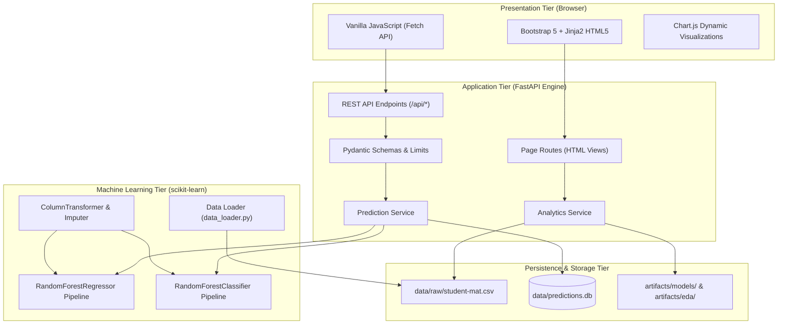

# Student Performance Prediction and Academic Risk Analysis

[](https://www.python.org/)
[](https://fastapi.tiangolo.com/)
[](https://scikit-learn.org/)
[](https://getbootstrap.com/)
[]()
[](LICENSE)

An end-to-end Machine Learning web application for educational analytics, continuous final grade estimation, and academic risk classification. Built with **scikit-learn**, **FastAPI**, **Bootstrap 5**, **Chart.js**, and **SQLite**.

---

## 1. Academic Context & Candidacy
- **Student Name:** Mutyala Pramod Abhiram
- **Roll Number:** `238T1A05B2`
- **Institution:** Dhanekula Institute of Engineering & Technology (DIET), Vijayawada
- **Department:** Computer Science and Engineering
- **Academic Year:** 2026 – 2027
- **Internship Domain:** Artificial Intelligence & Machine Learning (AI & ML)
- **Internship Period:** 04 May 2026 to 27 June 2026 (8 Weeks)
- **Collaborating Partner:** ExcelR Edtech Pvt. Ltd., in collaboration with APSCHE

---

## 2. Problem Statement & Research Motivation
Student underperformance and subject failure in foundational secondary mathematics are commonly detected only after end-of-term examinations have concluded, when remedial counseling can no longer avert failure. 

Furthermore, existing academic data mining literature frequently suffers from **circular data leakage**: models incorporate proximate intermediate term grades ($G1$ and $G2$) to predict final grades ($G3$). While this artificially inflates $R^2$ scores, it renders models functionally useless for proactive interventions at the beginning of an academic term.

This application implements a **strict early-warning experimental design**:
1. Intermediate exam marks ($G1$ and $G2$) are strictly isolated and excluded from model feature inputs.
2. Predictions are made entirely from 30 demographic, family, study-habit, and lifestyle attributes available on day one.
3. Continuous grade estimates are mapped into actionable pedagogical risk tiers with concrete counseling recommendations.

---

## 3. Key Features

- **Executive Analytics Dashboard:** Real-time KPI summaries, grade distribution histograms, study time vs. score relationships, and absence impact curves powered by Chart.js.
- **Interactive Dataset Explorer:** Searchable, filterable 395-student table browser with variable schema dictionaries and client-side CSV validation diagnostics.
- **Single Student Predictor:** Real-time inference form across 30 validated features with visual score gauges, probability distributions, risk badges, and demo presets (At-Risk, Moderate, High-Achiever).
- **Bulk CSV Batch Prediction:** Drag-and-drop CSV upload, row-level validation (no silent drops), and one-click downloadable enriched CSV exports.
- **Live Model Diagnostics:** Candidate algorithm benchmark tables, hold-out confusion matrix, and top-15 predictive feature importance rankings loaded dynamically from serialized metadata.
- **Audit Logging & History:** SQLite prediction audit trail with server-side pagination and safe demonstration reset modals.
- **Complete Test Coverage:** 29 automated unit, integration, and UI smoke tests executed via pytest.

---

## 4. System Architecture



---

## 5. Technology Stack

- **Backend:** Python 3.11+, FastAPI, Uvicorn, Pydantic v2, SQLAlchemy, SQLite
- **Machine Learning:** pandas, NumPy, scikit-learn, joblib, Matplotlib, Seaborn
- **Frontend:** HTML5, CSS3, Bootstrap 5.3.3, Vanilla JavaScript, Chart.js 4.4.2 CDN, Jinja2 Templates
- **Testing & Tooling:** pytest, FastAPI TestClient, Git

*Note: Built with zero heavy Node.js dependencies, paid cloud APIs, or proprietary framework lock-in.*

---

## 6. Dataset & Early-Warning Feature Schema

Sourced from the public [UCI Machine Learning Repository: Student Performance Dataset](https://archive.ics.uci.edu/dataset/320/student+performance) (Cortez & Silva, 2008), comprising 395 secondary school students in mathematics (`student-mat.csv`).

### Feature Schema (30 Early-Warning Indicators)
- **13 Numerical Features:** `age` (15-22), `Medu` (0-4), `Fedu` (0-4), `traveltime` (1-4), `studytime` (1-4), `failures` (0-4), `famrel` (1-5), `freetime` (1-5), `goout` (1-5), `Dalc` (1-5), `Walc` (1-5), `health` (1-5), `absences` (0-93).
- **17 Categorical Features:** `school` (GP, MS), `sex` (F, M), `address` (U, R), `famsize` (LE3, GT3), `Pstatus` (T, A), `Mjob` (5 classes), `Fjob` (5 classes), `reason` (4 classes), `guardian` (3 classes), `schoolsup` (yes/no), `famsup` (yes/no), `paid` (yes/no), `activities` (yes/no), `nursery` (yes/no), `higher` (yes/no), `internet` (yes/no), `romantic` (yes/no).
- **Target ($G3$):** Final mathematics grade on the official Portuguese 0–20 scale.
- **Strictly Excluded Variables:** `G1` (first period grade), `G2` (second period grade).

---

## 7. Empirical Machine Learning Benchmarks

Evaluated on an 80/20 train/test hold-out split (`random_state=42`) with 5-fold cross-validation conducted strictly on the training partition:

### Regression Benchmark (Final Grade $G3$, 0–20 Scale)
| Algorithm Candidate | 5-Fold CV RMSE | Test Set MAE | Test Set RMSE | Test Set $R^2$ | Status |
| :--- | :---: | :---: | :---: | :---: | :---: |
| **DummyRegressor (Baseline)** | 4.6384 | 3.2730 | 4.3610 | -0.0004 | Evaluated |
| **Ridge Regression** | 4.4802 | 3.2278 | 4.3902 | -0.0139 | Evaluated |
| **RandomForestRegressor** | **3.9381** | **2.9471** | **3.9518** | **0.1785** | **Selected** |
| **HistGradientBoostingRegressor** | 4.0569 | 3.0186 | 4.0507 | 0.1368 | Evaluated |

### Academic Risk Classification Benchmark (Cost-Sensitive Balanced Weighting)
| Classifier Algorithm | Test Accuracy | Macro F1-Score | Weighted F1-Score | Status |
| :--- | :---: | :---: | :---: | :---: |
| **DummyClassifier (Baseline)** | 41.77% | 0.1964 | 0.2462 | Evaluated |
| **RandomForestClassifier** | **54.43%** | **0.5494** | **0.5354** | **Selected** |
| **HistGradientBoostingClassifier** | 48.10% | 0.4703 | 0.4650 | Evaluated |

### Top Predictive Feature Importances
1. `absences` — Number of missed classes (strongest negative indicator).
2. `failures` — Past course failures (indicator of prior learning deficit).
3. `Medu` / `Fedu` — Parental education levels.
4. `studytime` — Weekly study commitment outside school.
5. `age` — Age distribution relative to cohort.

---

## 8. Installation & Execution Guide

### 8.1 Windows (PowerShell)
```powershell
# 1. Clone repository
git clone https://github.com/PramodAbhiramMutyala/student-performance-ml.git
cd student-performance-ml

# 2. Create virtual environment
python -m venv .venv
.\.venv\Scripts\Activate.ps1

# 3. Install dependencies
python -m pip install --upgrade pip
python -m pip install -r requirements.txt

# 4. Download and verify dataset
python scripts/download_dataset.py

# 5. Train models and generate visual EDA artifacts
python -m src.ml.train

# 6. Launch the FastAPI application
uvicorn src.main:app --reload --host 127.0.0.1 --port 8000
```

### 8.2 Linux / macOS (Bash)
```bash
# 1. Clone repository
git clone https://github.com/PramodAbhiramMutyala/student-performance-ml.git
cd student-performance-ml

# 2. Create virtual environment
python3 -m venv .venv
source .venv/bin/activate

# 3. Install dependencies
pip install --upgrade pip
pip install -r requirements.txt

# 4. Download dataset & train models
python scripts/download_dataset.py
python -m src.ml.train

# 5. Start server
uvicorn src.main:app --reload --host 127.0.0.1 --port 8000
```

### 8.3 Docker Deployment
```bash
docker compose up --build
```
Access the application in your browser at: **`http://127.0.0.1:8000`**

---

## 9. Verification & Automated Testing

Run the full automated test suite (29 tests across ML, API, Database, and UI routes):
```bash
python -m pytest
```

Expected output:
```
======================== 29 passed in 0.92s ========================
```

---

## 10. API Endpoints Summary

| Method | Endpoint | Description |
| :--- | :--- | :--- |
| `GET` | `/health` | System health check & subsystem readiness |
| `GET` | `/api/analytics/overview` | Summary counts, mean grade & passing rates |
| `GET` | `/api/analytics/distributions` | Chart.js distribution feeds |
| `GET` | `/api/model/info` | Active model metadata & target isolation rules |
| `GET` | `/api/metrics` | Actual empirical cross-validation & test metrics |
| `POST` | `/api/predict` | Single student performance & risk inference |
| `POST` | `/api/predict/batch` | Batch JSON inference with row-level validation |
| `POST` | `/api/dataset/validate` | Multipart CSV schema verification |
| `POST` | `/api/dataset/predict` | Multipart CSV inference with downloadable enriched file |
| `GET` | `/api/predictions` | Paginated SQLite prediction audit history |
| `DELETE` | `/api/predictions` | Clear demonstration audit history |

Interactive Swagger documentation is available at **`http://127.0.0.1:8000/docs`**.

---

## 11. Project Directory Structure

```
student-performance-ml/
├── README.md                          # Comprehensive documentation
├── LICENSE                            # MIT License
├── .gitignore                         # Git exclusion rules
├── .env.example                       # Environment template
├── requirements.txt                   # Pinned Python dependencies
├── pyproject.toml                     # Project metadata & pytest config
├── Dockerfile                         # Container build definition
├── docker-compose.yml                 # Multi-container orchestration
├── data/
│   ├── README.md                      # Data privacy & licensing
│   ├── raw/student-mat.csv            # Original UCI dataset
│   ├── demo_valid_batch.csv           # 25-row test batch
│   └── demo_invalid_batch.csv         # 5-row error test batch
├── artifacts/
│   ├── README.md                      # Artifact regeneration guide
│   ├── eda/                           # Real generated EDA plots
│   │   ├── grade_distribution.png
│   │   ├── correlation_heatmap.png
│   │   ├── studytime_vs_grade.png
│   │   ├── absences_vs_grade.png
│   │   └── failures_vs_grade.png
│   └── models/                        # Serialized pipelines & metrics
│       ├── best_regressor.joblib
│       ├── risk_classifier.joblib
│       ├── metrics.json
│       └── model_metadata.json
├── docs/
│   ├── architecture.md                # System design & Mermaid diagrams
│   ├── dataset.md                     # Variable dictionary & compliance
│   ├── methodology.md                 # ML formulation & early warning
│   ├── api.md                         # OpenAPI specifications
│   ├── testing.md                     # 29-test verification report
│   ├── limitations.md                 # Ethical & technical boundaries
│   ├── report-outline.md              # DIET B.Tech 20-25 page report
│   └── presentation-slides.md         # 22-slide viva presentation deck
├── notebooks/
│   └── exploratory_analysis.ipynb     # Interactive Jupyter EDA notebook
├── src/
│   ├── __init__.py
│   ├── main.py                        # FastAPI application entrypoint
│   ├── config.py                      # Feature schemas, thresholds, settings
│   ├── ml/
│   │   ├── __init__.py
│   │   ├── data_loader.py             # File loader & delimiter sniffing
│   │   ├── validation.py              # Multi-tier schema validator
│   │   ├── preprocessing.py           # ColumnTransformer & risk categories
│   │   ├── train.py                   # Model benchmark & training runner
│   │   ├── evaluate.py                # Regression & classification metrics
│   │   └── predict.py                 # Thread-safe inference singleton
│   ├── api/
│   │   ├── __init__.py
│   │   ├── api_routes.py              # RESTful API endpoints
│   │   ├── page_routes.py             # Jinja2 HTML page handlers
│   │   └── dependencies.py            # DB session & model dependencies
│   ├── schemas/
│   │   ├── __init__.py
│   │   ├── student.py                 # Pydantic 30-feature input schema
│   │   └── prediction.py              # Request and response models
│   ├── services/
│   │   ├── __init__.py
│   │   ├── prediction_service.py      # Inference & SQLite logging
│   │   └── analytics_service.py       # Dataset & chart data service
│   ├── database/
│   │   ├── __init__.py
│   │   ├── session.py                 # SQLAlchemy SQLite engine & session
│   │   └── models.py                  # PredictionLog ORM table
│   └── templates/                     # Jinja2 HTML views
│       ├── base.html                  # Layout with Google Fonts & CDN
│       ├── dashboard.html             # Route: /
│       ├── dataset.html               # Route: /dataset
│       ├── predict.html               # Route: /predict
│       ├── batch_predict.html         # Route: /batch-predict
│       ├── model_evaluation.html      # Route: /model-evaluation
│       ├── history.html               # Route: /history
│       └── partials/
│           ├── navbar.html
│           ├── footer.html
│           └── alerts.html
├── static/
│   ├── css/style.css                  # Modern navy & teal design system
│   └── js/main.js                     # Vanilla JS toast & badge utilities
├── tests/
│   ├── __init__.py
│   ├── conftest.py                    # Fixtures & in-memory test DB
│   ├── test_ml.py                     # ML unit tests
│   ├── test_api.py                    # Endpoint & page smoke tests
│   └── test_database.py               # ORM & pagination tests
└── scripts/
    ├── download_dataset.py            # Reproducible data acquisition
    └── generate_demo_data.py          # Demo batch generator
```

---

## 12. Ethical Considerations & Responsible AI Statement

1. **Advisory Decision Support:** Model predictions are probabilistic estimates intended solely for proactive early counseling support. Under no circumstances should automated model outputs be used to assign official academic grades or enforce punitive disciplinary sanctions.
2. **Human-in-the-Loop:** Predictions must always be reviewed by qualified human educators who understand the student's broader personal and educational context.
3. **Data Privacy:** In accordance with ethical standards, no student names, contact information, or personally identifiable information (PII) are ingested or stored.

---

## 13. License
This project is licensed under the MIT License — see the [LICENSE](LICENSE) file for details.
