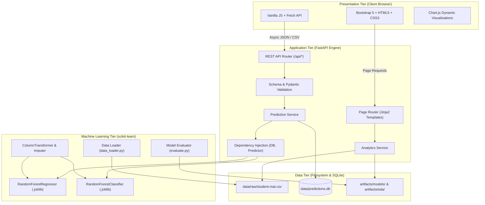

# System Architecture & Technical Design

## 1. High-Level Architecture Overview
The **Student Performance Prediction and Academic Risk Analysis System** is engineered as a modular, decoupled web application. It combines scikit-learn machine learning pipelines, a high-throughput asynchronous FastAPI backend, a responsive Bootstrap 5 client interface with Chart.js visualization, and an ACID-compliant SQLite audit store.

---

## 2. Component Decomposition

### 2.1 Presentation Tier
- **Templates (`src/templates/`)**: Jinja2 server-rendered views structured with inheritance (`base.html`), partials (`navbar.html`, `footer.html`, `alerts.html`), and page templates.
- **Styling (`static/css/style.css`)**: Tailored design system with a clean executive aesthetic utilizing deep navy (`#0f172a`), slate (`#1e293b`), and teal (`#0d9488`).
- **Client Logic (`static/js/main.js`)**: Pure vanilla JavaScript utilizing the native Fetch API for zero-dependency async interactions, toast notifications, and client form handling.
- **Client Charting**: Pinned Chart.js v4.4.2 CDN library rendering dynamic distribution and scatter charts populated by backend API endpoints.

### 2.2 Application Tier (FastAPI)
- **Application Factory (`src/main.py`)**: Asynchronous lifespan manager for database schema initialization and ML pipeline memory pre-loading.
- **API Routing (`src/api/api_routes.py`)**: REST endpoints serving health status, statistical summaries, single inferences, batch predictions, and audit log queries.
- **Page Routing (`src/api/page_routes.py`)**: Handles server-side HTML rendering and view context injection.
- **Request Schemas (`src/schemas/`)**: Pydantic v2 schemas providing automatic data validation, range bounds checking, and type conversion.
- **Services (`src/services/`)**: Business logic orchestration separating HTTP request handling from machine learning inference and database transactions.

### 2.3 Machine Learning Pipeline Tier
- **Data Acquisition (`scripts/download_dataset.py`)**: Automated, reproducible downloading and verification of the UCI Student Performance archive.
- **Schema Validation (`src/ml/validation.py`)**: Multi-level inspection verifying column presence, data types, missing value ratios, duplicate records, categorical domain compliance, and numerical range limits.
- **Preprocessing Pipeline (`src/ml/preprocessing.py`)**: ColumnTransformer orchestrating:
  - Numerical Pipeline: Median imputation (`SimpleImputer`) and standardization (`StandardScaler`).
  - Categorical Pipeline: Most-frequent imputation and one-hot encoding (`OneHotEncoder(handle_unknown='ignore')`).
  - Feature Isolation: Strict exclusion of `G1`, `G2`, and `G3` from the early-warning feature set.
- **Training Pipeline (`src/ml/train.py`)**: Automated 5-fold cross-validation on the 80% training set, hold-out evaluation on the 20% test set, model candidate comparison, and joblib serialization.
- **Inference Engine (`src/ml/predict.py`)**: Thread-safe predictor singleton providing single-record and batch inference with automatic clamping and graceful degradation.

### 2.4 Persistence & Audit Tier
- **Database Engine (`src/database/session.py`)**: SQLAlchemy ORM with SQLite backend (`data/predictions.db`).
- **Audit Model (`src/database/models.py`)**: `PredictionLog` recording inference timestamp, execution type (single/batch), model version, predicted continuous score, academic risk tier, and non-identifying input metadata.
