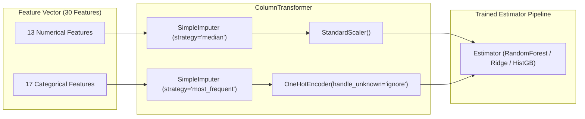

# Machine Learning Methodology & Experimental Design

## 1. Problem Formulation
Academic risk analysis is frequently undermined by circular data leakage when models rely on proximate intermediate grades (such as `G1` and `G2`) to predict final outcomes (`G3`). While including `G1` and `G2` artificially inflates $R^2$ scores above 0.80, it renders models functionally useless for early intervention at the beginning of an academic term.

This project implements an **Early-Warning Predictive Experiment**:
- **Goal:** Predict final student performance and academic risk *before* intermediate exams occur, using exclusively demographic, lifestyle, support, and baseline academic history indicators.
- **Leakage Prevention:** `G1`, `G2`, and `G3` are isolated and strictly excluded from the feature space $X$.

---

## 2. Target Variable Definitions

### 2.1 Regression Target: Continuous Grade ($G3$)
- **Domain:** Portuguese secondary education scale ranging from $0$ to $20$ (integer marks).
- **Distribution:** Bimodal distribution with a primary peak around $10$–$14$ and a secondary cluster at $0$ (representing students who withdrew or failed to sit for the final examination).
- **Dataset Mean:** $10.42 \pm 4.58$.

### 2.2 Classification Target: Academic Risk Category
To translate quantitative predictions into actionable pedagogical interventions, $G3$ is categorized into three educational risk tiers based on official Portuguese grading standards:
1. **High Academic Risk ($G3 < 10.0$):**
   - Corresponding to an outright failing grade in the Portuguese system.
   - Requires immediate remedial tutoring, structured study halls, and parent-teacher contact.
2. **Moderate Academic Risk ($10.0 \le G3 < 14.0$):**
   - Corresponding to a minimal satisfactory passing mark.
   - Student is at risk of falling behind if study habits decline.
   - Recommended interventions include peer study groups and bi-weekly milestone check-ins.
3. **Low Academic Risk ($G3 \ge 14.0$):**
   - Corresponding to good to superior academic performance.
   - Focus shifts to enrichment opportunities and advanced mentorship.

---

## 3. Data Splitting & Preprocessing Workflow

### 3.1 Partitioning Strategy
- **Partition Ratio:** 80% Training ($N = 316$), 20% Hold-out Testing ($N = 79$).
- **Reproducibility:** Seed fixed at `random_state = 42`.
- **Stratification:** Splitting is stratified across the academic risk categories to preserve class proportions in both train and test partitions.
- **Cross-Validation:** 5-fold cross-validation is executed **exclusively** within the 80% training partition to guide model selection.

### 3.2 Preprocessing Architecture (Scikit-Learn Pipeline)

---

## 4. Candidate Algorithms & Empirical Benchmark

### 4.1 Regression Candidates Evaluated
1. **DummyRegressor (Baseline):** Predicts the mean training target. Establishes the performance floor.
2. **Ridge Regression:** Regularized linear model penalizing large weights ($\alpha = 1.0$).
3. **RandomForestRegressor:** Ensemble of 100 decision trees (`max_depth = 8`), robust to non-linear feature interactions.
4. **HistGradientBoostingRegressor:** Histogram-based gradient boosting trees inspired by LightGBM, capable of modeling subtle non-linear dependencies.

### 4.2 Classification Candidates Evaluated
1. **DummyClassifier (Baseline):** Predicts the most frequent class.
2. **RandomForestClassifier:** Multi-class ensemble with `class_weight='balanced'` to offset risk category imbalances.
3. **HistGradientBoostingClassifier:** Boosted classification tree ensemble with cost-sensitive class balancing.

---

## 5. Evaluation Metrics
- **Mean Absolute Error (MAE):** Average magnitude of prediction errors in grade points:
  $$\text{MAE} = \frac{1}{n} \sum_{i=1}^n |y_i - \hat{y}_i|$$
- **Root Mean Squared Error (RMSE):** Penalizes larger deviation errors:
  $$\text{RMSE} = \sqrt{\frac{1}{n} \sum_{i=1}^n (y_i - \hat{y}_i)^2}$$
- **Coefficient of Determination ($R^2$):** Proportion of target variance explained by features:
  $$R^2 = 1 - \frac{\sum (y_i - \hat{y}_i)^2}{\sum (y_i - \bar{y})^2}$$
- **Macro & Weighted F1-Scores:** Harmonic mean of precision and recall accounting for multi-class distribution.
